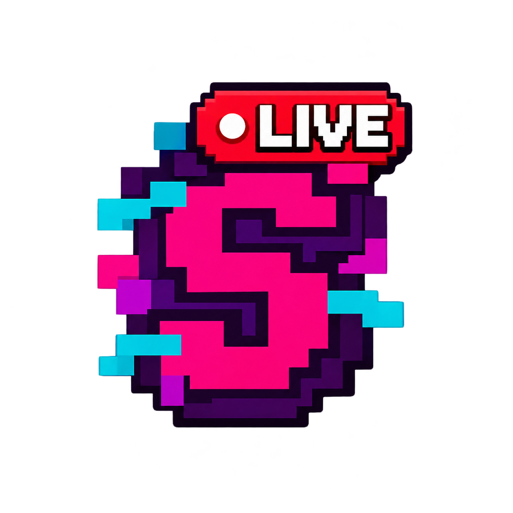

<h1 align="center">
   SMB Camera
</h1>

  <a href="https://github.com/smbprdz/smb-camera/releases/tag/v0.19.3-beta"><strong>Download beta</strong></a> ·
  <a href="docs/INSTALL-WINDOWS.md">Windows guide</a> ·
  <a href="docs/INSTALL-IOS.md">iPhone setup</a> ·
  <a href="docs/INSTALL-WINDOWS.md#obs-e-gravação">OBS</a> ·
  <a href="README.md">Português</a>

  
  
  
  
  
  

<strong>Your iPhone in OBS, with background removal and original video recording.</strong>

  

Screenshot of the app using a demonstration signal and a fictional subject.

## What you can do

- **Control the camera from Windows.** Select lenses and adjust focus, zoom, exposure, framing, color and LUTs.
- **Use the SMB Camera source in OBS.** Use a transparent background, an image, a GIF, or a looping video with [optional NVIDIA background removal](docs/NVIDIA-BETA.md).
- **Record the original signal.** Save the incoming H.264 to MOV without re-encoding and optionally record the iPhone microphone.

## Beta

| Component | Tested reference |
| --- | --- |
| iPhone | SMB Camera 0.9 on iPhone 11 Pro Max with iOS 18.3.1 |
| PC | Desktop 0.19.3 on Windows 11 x64 with RTX 3060 Laptop |
| Video | 1080p30 SDR H.264 over USB |
| OBS | SMB Camera source with OBS x64 32.2.2 and OBS 33.0.0 Portable |
| Recording | MOV with original H.264 video and optional PCM audio |

On the reference setup, USB delivered 1080p30 and recorded a MOV with iPhone microphone audio. With NVIDIA background removal on, the OBS source published about 24 frames per second in the last measured window. Performance during gameplay, sustained Wi-Fi, and installation on other PCs are still awaiting validation.

The iPhone app requires [personal signing](docs/INSTALL-IOS.md). The beta focuses on the OBS source and original recording. The Windows virtual webcam is under development. Setup and contribution guides are currently in Portuguese.

**Background removal:** optional, validated on NVIDIA RTX 30. AMD GPUs are not supported for this effect yet.

[Contributing](CONTRIBUTING.md) · [Protocol](docs/PROTOCOL.md) · [Privacy](docs/PRIVACY.md) · [License](LICENSE)
