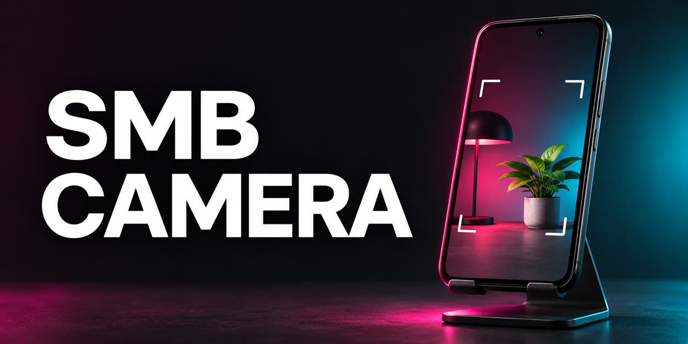
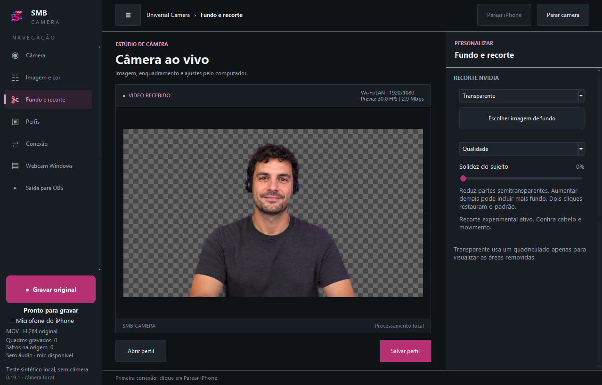

  

<strong>Use seu iPhone como câmera no Windows e no OBS.</strong>

  
  
  
  

  <a href="docs/INSTALL-WINDOWS.md"><strong>Começar no Windows</strong></a> ·
  <a href="docs/INSTALL-IOS.md">Preparar o iPhone</a> ·
  <a href="docs/INSTALL-WINDOWS.md#obs-e-gravação">Configurar o OBS</a> ·
  <a href="README.en.md">English</a>

## O painel

*Captura do painel real com sinal de demonstração e uma pessoa fictícia.*

- **Controle pelo PC.** Selecione lente, foco, zoom e exposição. Ajuste cor, enquadramento e LUTs no painel.
- **Fonte própria para OBS.** Use fundo transparente, imagem, GIF ou vídeo com o [recorte NVIDIA opcional](docs/NVIDIA-BETA.md).
- **Gravação original.** Salve o vídeo H.264 recebido em MOV, sem recompressão, com a opção de incluir o microfone do iPhone.

## Beta

| Componente | Referência testada |
| --- | --- |
| iPhone | SMB Camera 0.9 no iPhone 11 Pro Max com iOS 18.3.1 |
| PC | Desktop 0.19.1 no Windows 11 x64 com RTX 3060 Laptop |
| Vídeo | USB 1080p30 em H.264 SDR |
| OBS | Fonte SMB Camera em OBS x64 32.2.2 e 33.0.0 portátil |
| Gravação | MOV com H.264 original e áudio PCM opcional |

O app iOS usa [assinatura pessoal](docs/INSTALL-IOS.md). A fonte OBS usa uma conexão local e a beta foca em OBS e em gravação original. O componente de webcam do Windows está em desenvolvimento.

## Código e colaboração

O painel fica em `ucs/`, o app do iPhone em `apps/ios/` e a fonte do OBS em `integrations/obs/`. As instruções para reproduzir o ZIP, rodar testes e reportar um problema ficam em [Contribuir](CONTRIBUTING.md).

[Protocolo](docs/PROTOCOL.md) · [Privacidade](docs/PRIVACY.md) · [Licença](LICENSE) · [Componentes de terceiros](THIRD-PARTY.md)
